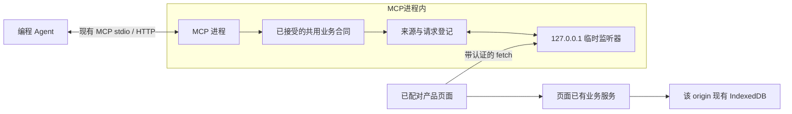

# Chrome 真实数据接入：进程内回环桥接方案与隔离原型

任务：`PO-MCP-CHROME-20261115`，轮次 1，2026-11-15。基线：`82a40b91ae9a0583f27bec121da03a157aacd42f`，独立分支 `feature/mcp-chrome-bridge`。

## 结论与交付边界

推荐由**已打开的产品页面执行现有业务能力，主动连接现有 MCP 进程内的临时回环监听器**。Agent 继续使用原有 MCP 连接；浏览器桥接是服务内部的执行通道，不是第二套 MCP 业务接口，也不建立镜像数据库。不依赖 SQLite，不增设独立常驻服务。

普通网页/PWA 与扩展必须作为不同来源配对和选择。首版推荐两者均要求产品页面保持打开；扩展页的网络权限组合还需专项验证。关闭页面、浏览器挂起或 MCP 结束均允许连接失效，不能自动改用另一来源。扩展 worker 可作为后续选项，不能把其后台存活写成现有保证。

本轮产出文档和 [隔离连接原型](../../experiments/mcp-chrome-bridge/README.md)。已经验证的是 **Chrome 隔离上下文、原生 IndexedDB 样本与回环通道**，没有接入产品 Dexie、用户配置、收藏或真实模型，也未运行付费请求。业务接口合同由桌面 MCP/共用能力负责人制定；统筹已接受提交 `34898b04d07cb2abf656f13117cf22d5802f7d99` 的草案 v0.2，本文第 7.1–7.2 节据此对齐。接受的是设计，不是已上线工具；本线不另定义测试、比较、评估接口。

## 1. 当前源码事实

以下位置以本轮基线为准，后续整合应重新核对。

| 源码 | 核实结果与意义 |
| --- | --- |
| `packages/web/src/App.vue:14`、`packages/extension/src/App.vue:13` | 均渲染 `PromptOptimizerApp`，可在共用 UI 中挂接连接入口。 |
| `packages/ui/src/composables/system/useAppInitializer.ts:269` | 非 Electron 分支用 `StorageFactory.create('dexie')`；先做现有启动检查，再初始化业务服务。连接执行器必须等服务就绪。 |
| `packages/core/src/services/storage/dexieStorageProvider.ts:21`、`:44` | 正常主库 `PromptOptimizerDB`，`storage` 表保存结构化键值；测试可通过 `window.__TEST_DB_NAME__` 隔离。并非磁盘 JSON 文件。 |
| `packages/core/src/services/image/storage.ts:23`、初始化器 `:287`、`:299` | 图像有独立 Dexie 库及表：`PromptOptimizerImageDB`、`PromptOptimizerFavoriteImageDB`；不能把主表导出当全部产品数据。 |
| 初始化器 `:457`、`:502` | 页面已有模型/收藏、LLM 和评估等服务；后续执行复用现有业务能力，只读发现按第 7.2 节消费共用无初始化 reader。 |
| `packages/core/src/services/model/manager.ts:829`、`:844` | `getAllModels()` 经 `getModelsFromStorage()` 读取，缺失/解析失败会回退默认配置；配置还包含 `connectionConfig`。不能直接当合同只读 reader 或原样输出。 |
| `packages/core/src/services/favorite/manager.ts:55`、`:127`、`:337` | 现有 manager 提供筛选/分页，但构造即初始化并迁移旧数据；应复用纯解析/投影语义，不能为 MCP 读取重建该 manager。 |
| `packages/extension/public/background.js:1`、`manifest.json` | 现有 worker 只开 `index.html`，`permissions` 为空，无 host/nativeMessaging/内容脚本/外部连接桥。`minimum_chrome_version` 仍为 88。 |
| `packages/mcp-server/src/adapters/core-services.ts:68` | MCP 当前创建 `MemoryStorageProvider` 并从环境配置默认模型；并未连接页面的真实配置。 |
| `packages/mcp-server/src/index.ts:356`、`:474` | 同一入口支持 HTTP/stdio；当前先初始化内存业务服务。Chrome 只读发现不能继续以“必须有环境变量模型”作为前置条件，整合由 MCP 负责人改。 |
| 同文件 `:399`、`:503` | 现有 HTTP 分支允许通配来源并关闭 DNS rebinding 防护；信号处理直接退出。新桥**不能继承该配置**，应单独绑定回环并纳入统一清理。本轮不修改这些生产文件。 |

## 2. 来源、页面与数据边界

| 场景 | 推荐路径 | 关闭/多页面行为 | 本轮状态 |
| --- | --- | --- | --- |
| 普通 HTTPS 网页、自部署网页 | 产品顶层页面中的连接 UI → 页面命令执行器 → MCP 进程内回环 HTTP | 页面关闭/冻结后不可用；同 origin 多页面分别登记，Agent 明确选定其中一个。 | 本地双 origin 样本已验证；公网 HTTPS/LNA 尚未验证。 |
| 安装的 PWA | 同上，来源仍是其 Web origin | 安装不会获得跨 origin 数据权限；PWA 窗口关闭后不保证后台执行。 | 架构推断，未实测安装 PWA。 |
| `chrome-extension://<id>` 产品页 | 同一页面执行器，扩展权限化回环连接 | 只读其扩展 origin 的库；关闭页面后首版断连。不能因此改读普通网站。 | 尚未安装/验证扩展原型。 |
| 扩展 worker 后续方案 | 在扩展自身 worker 中初始化可运行的服务，并共享同一合同/来源登记 | worker 可能被终止，必须允许恢复后产生新连接句柄。打开页面时与 worker 选定一个执行者，避免重复任务。 | 仅候选，不能直接复用依赖 Vue/DOM 的初始化器。 |

Chrome 官方说明扩展自己的页面和 worker 可共享扩展 origin 的 IndexedDB，内容脚本的 Web Storage 则属于所在网页。跨站 iframe 还可能使用分区存储，因此首版限制为产品顶层页面，不把嵌入页当同一份数据。[Chrome 存储规则](https://developer.chrome.com/docs/extensions/develop/concepts/storage-and-cookies)

来源身份至少区分：来源种类、浏览器实际 origin、产品版本、存储/合同版本、用户可辨认的安装标签、页面实例、此次连接代次和就绪状态。扩展另有扩展 ID/隐身上下文。网页不能可靠获取 Chrome profile 路径或统一 profile ID；不要伪造这类身份。可在现有偏好中保存随机安装标识和用户标签，无需新增数据库服务；该标识只用于辨认，不能作为授权秘密，导入/重置后也不能单独用来证明身份。

MCP 为每次配对创建不透明来源登记，绑定 owner、实际 origin、安装/页面实例和连接代次。按 v0.2，`sources.list` 返回 `sourceId`，`sources.open` 明确选源/访问级别并返回 `connectionId`，后续业务请求使用该连接，由路由层恢复真实来源。即使当前只有一个来源也不省略绑定；多个同名标签必须可区分。相同 origin 的两个页面通常共享同一份存储，但有独立内存状态，仍不能按“最近活动页”静默替换执行者。

## 3. 现有 MCP 进程承载方式

Node 的 `http.createServer()` 可以直接由现有 MCP 进程创建，不需要启动子进程。采用随机空闲端口，固定字面地址 `127.0.0.1`；只在连接功能启用/配对时创建。浏览器向它发起带认证的 POST 并拉取命令，MCP 通过进程内方法投递请求，不能开放无认证的“控制 Agent”端点。首版可用有界短轮询，后续再替换为长轮询/流；两者都不改变业务接口。

原型 `startBridge()` 已以这种可嵌入模块形式工作。`demo.mjs` 在**一个 Node 进程内**额外开两个 fixture 网站作为测试环境；这两个网站不会成为生产组件。**本轮未把该模块接进真实 MCP stdio/SDK 启停，因此不声称已完成现有 MCP 集成。**

stdio 的 stdout 只放 MCP 消息；桥接日志走 stderr 且不记秘密/正文。初始化必须支持“尚无已配对来源”，不要静默回退内存或环境变量默认模型。stdio 关闭、MCP owner 断开、SIGINT/SIGTERM、主动退出时清理 owner 的来源、待执行任务、令牌、监听器；最后一个 owner 退出后关闭监听器。HTTP 多客户端不可共享无归属的来源池。

适用范围是浏览器与 MCP 在可互通的同一台机器/网络命名空间。远端 Agent、Docker、WSL 的 `127.0.0.1` 不保证指向浏览器所在主机；默认明确报不可达，端口映射另行设计并核验，不扩大到 `0.0.0.0`。

## 4. 最小连接约定

以下是连接层要求；业务字段与语义以第 7.1 节引用的已接受 v0.2 设计为准，不能从这些条目或 fixture 协议推导另一套产品 API。

1. **配对入口**：MCP owner 发起配对，指定预期准确 origin；产品连接 UI 显示连接对象/本次允许范围，由用户在该页面启动。使用密码学随机、短期、一次性票据，不在 query、常规日志、配置或浏览器持久存储中保存。不要扫描端口或自动配对所有同名产品页。
2. **双向核验边界**：票据持有者接受本地进程身份；MCP 只接受预先允许的 wire `Origin`、正确 `Host` 和票据。hello 的 origin/标题仅是声明，不能覆盖请求头。它不是操作系统级认证：恶意本地进程可伪造 HTTP 头，已经控制产品 origin 的脚本也在该 origin 的信任边界内。
3. **会话**：配对换取仅内存中的连接令牌，绑定 owner、origin、实例与连接代次。旧令牌/旧句柄失效后不复用；服务重启必须重新配对。协议版本不兼容就拒绝。产品未初始化或存储修复失败时只报告未就绪，不执行业务。
4. **来源约束**：监听器只接受准确 allowlist，拒绝 `null`、缺失/未知 Origin、错误 Host；精确 CORS，不允许 `*`、Cookie 凭据或 GET 变更。校验方法、Content-Type、JSON schema、体积和并发；限制票据/来源/队列数量。不得提供任意脚本执行、任意存储 key 或任意代理 URL。
5. **来源固定**：每个产品业务请求用受该 owner 所有的 `connectionId` 派发，结果由登记项补上真实来源；执行器自报的来源不能改写它。连接代次变化、页面关闭、租约过期均失败，不重放到另一个页面。初期不承诺跨断连的 exactly-once 或恢复写入。
6. **请求生命周期**：唯一请求 ID、有界 deadline、明确的排队/执行/完成状态。取消和超时向页面传递 AbortSignal 并拒绝晚到结果。网络已发出的模型请求可能已计费；取消不能承诺撤销已完成副作用。写入重试/幂等性由业务合同统一决定，首版不自动重试。
7. **断连**：`pagehide` 主动断开仅是 best effort；以租约最终确认失联，不能只依赖 unload。冻结/后台节流/系统休眠会使租约过期；UI 与 Agent 必须显示不可用。恢复时新建连接，必要时重新选择来源。执行器停止正在进行的请求；取消投递失败也要让调用端及时结束。
8. **秘密边界**：执行器内部保留 API key、授权头、私有连接参数；模型清单返回合同定义的公开字段与配置状态。错误/进度不能透传 SDK 完整请求。收藏内容属于用户数据，读取依当前连接允许范围，不把结果塞进服务日志。

### 原型中的具体样本协议

`po-bridge-experiment/1` 只接受 `kind=web-fixture`。`/connect` 用一次性票据换取连接令牌，`/poll` 拉取命令/取消，`/reply` 交回结果，`/disconnect` 释放。所有为认证 POST，OPTIONS 仅精确预检。source ID 是每次连接随机 UUID。

只允许 `fixture.list` 和 `fixture.wait` 两个样本动作；名字、JSON envelope、错误码都不能直接升级成产品合同。原型**没有 MCP owner 隔离、产品版本握手、业务 schema、用户范围确认、进度流或真实模型调用**；正式整合前必须补齐上述约定。

## 5. Chrome 网络权限与扩展要求

网页走 `fetch` 时，标准 CORS 与浏览器本地网络权限是两层检查。当前官方指引区分 `local-network` 与 `loopback-network`；公开/内网站点访问回环受相应权限约束。产品页面应是安全上下文，连接操作从明确的 UI 动作触发；查询权限名时允许旧 Chrome 抛出不支持，再根据实际请求错误显示原因。HTTPS → HTTP 回环请求按目标浏览器支持使用 `targetAddressSpace: 'loopback'`，页面 CSP 的 `connect-src` 也需允许该回环目标。不要要求用户关闭浏览器防护或忽略证书警告。[当前 Chrome LNA 指引](https://developer.chrome.com/docs/modern-web-guidance/guides/security/local-network-access)

旧 PNA 的 `Access-Control-Allow-Private-Network` 不能替代当前权限，原型没有加入它。**两个 loopback 网站互访不经过 public → loopback 权限边界**；本轮不能证明生产 HTTPS 的授权弹窗、拒绝恢复、企业策略及旧版兼容。当前官方指引已经覆盖 WebSocket 的权限限制，不能用早期博客中“WebSocket 尚未受限”的描述作为绕过方案。HTTP fetch 足以完成首版，不引入 WebSocket 依赖。

扩展若使用跨 origin 的特权 fetch，应声明最小的可选 host 权限（候选 `http://127.0.0.1/*`）并在连接时请求；产品代码仍固定具体端口及路径。不可扩大到所有网站，也不加入内容脚本或 `externally_connectable` 来兜底。现有 CSP 的 sandbox 配置属于 HTML 预览页，不是产品页授权依据。[扩展网络规则](https://developer.chrome.com/docs/extensions/develop/concepts/network-requests)、[可选权限](https://developer.chrome.com/docs/extensions/develop/concepts/declare-permissions)、[匹配模式](https://developer.chrome.com/docs/extensions/develop/concepts/match-patterns)

**待验证**：目标 Chrome 上扩展页/worker、可选 host 权限、LNA 与 wire Origin 的实际组合。本原型严格拒绝缺失 Origin，allowlist 校验也只支持标准 Web origin，不能直接登记 `chrome-extension://`；扩展 origin 需单独校验固定 ID。若扩展请求不带 Origin 头，不能照搬原型后对普通网页放宽检查，需要明确单独的扩展认证路径及其身份保证，再交合同负责人确认。manifest 最低版本 88 也不代表现代回环权限功能都可用。

## 6. 扩展 worker、Native Messaging 与备选

扩展 worker 能访问扩展 IndexedDB，但现有 Vue 页面初始化器不能直接搬过去。需抽出可运行于 worker 的服务装配、审查环境变量/DOM 依赖、协调页面与 worker 的缓存和并发、转交取消并处理 worker 重启。普通 PWA worker 也不能充当永久后台执行器。

Chrome 的 MV3 worker 通常在空闲后终止；活跃 WebSocket 消息或 Native Messaging 连接对生命周期有特定影响，但不提供浏览器退出后的执行保证。不为首版引入无限保活。关闭页面仍执行的需求应独立验收，不夹带进本轮连接方案。[扩展 worker 生命周期](https://developer.chrome.com/docs/extensions/develop/concepts/service-workers/lifecycle)

Native Messaging 仅是扩展备选：需要 `nativeMessaging` 权限、安装宿主程序/manifest、固定扩展 ID 的 `allowed_origins`，Windows 还需注册表登记，其他系统有各自安装路径。Chrome 会另起宿主进程，并使用带长度前缀的消息；`connectNative` 与逐条 `sendNativeMessage` 的进程生命周期不同。[Chrome Native Messaging](https://developer.chrome.com/docs/extensions/develop/concepts/native-messaging)

它不能直接连接/接管已被编程 Agent 启动并占用 stdio 的 MCP 进程。若要复用既有 MCP，还需额外宿主进程和本地 IPC 转接；不是零安装、零额外进程，也不能因此读取普通网页 origin。故当前优先回环方案。Native Messaging 可在明确不允许网页回环的环境下单独评估，不能静默回退或隐式注册。

WebMCP 官方仍描述为 proposed standard，当前文档给出 Chrome origin trial/本地 flag 及浏览器内工具发现。它可复用未来共用能力作为增强，但不等于通用编程 Agent 已能访问用户 Chrome 的远程 MCP 服务，故不作为本轮依赖。[Chrome WebMCP](https://developer.chrome.com/docs/ai/webmcp)

导出/导入文件可作为用户主动的数据交换备选，但不是实时真实数据接入；直接读取/修改 Chrome profile 的 IndexedDB 底层文件不列入实现范围。

## 7. 下一阶段最小改动与负责人输入

| 改动 | 负责边界 / 接受条件 |
| --- | --- |
| MCP 入口按需创建桥、注册来源、owner 隔离及统一清理 | MCP/共用能力负责人；不沿用旧 HTTP 通配来源，不要求网页模型已经转存到 MCP。 |
| 共用页面连接 composable 与小型设置入口 | Chrome 实现；在现有 `services` 就绪后注册执行器；由页面主动连接，显式配对/断开，不新增全局可被任意页面调用的服务对象。 |
| 文本模型读取适配 | 消费共用无初始化/无默认回退 reader，绑定页面既有存储连接；按 v0.2 `models.list` 白名单构造结果。不能直接用 `getAllModels()` 的缺失/损坏回退，不导出 `connectionConfig`。图像模型不在本轮只读范围。 |
| 收藏读取适配 | 通过同一存储连接读取已有收藏，复用 `promptAssetFromFavorite` 纯投影，按 v0.2 `assets.list/getVersion` 分开摘要与指定版本正文。不为读取重建 `FavoriteManager` 或写回投影；图片后续另行声明。 |
| 测试/比较/评估的真实执行 | 完全复用业务负责人接受的执行器与参数，使用页面既有服务与模型身份；本轮不命名或实现这些工具。并发/成本/取消语义先在共用合同确定。 |
| 扩展打包和权限 | 首版扩展页验证通过后再改 manifest；不预先安装到日常浏览器。worker 版独立立项，复用同一合同。 |

需要交给合同负责人的要求清单：

- 来源句柄和实际来源信息能贯穿每个业务调用/结果，来源列举能表达 `disconnected`、`not-ready`、版本不兼容与能力差异。
- 来源授权属于 MCP owner；连接票据不变成业务数据，也不能被其他 HTTP 客户端复用。
- 执行器可接 `AbortSignal`、deadline 与未来进度通知；连接代次变化可以使请求确定失败。
- 模型 ID 与来源一起解析；公开清单与内部凭据类型分开，不能把 core 的完整模型配置当公共 DTO。
- 收藏分页、图片引用、单次响应大小限制有统一语义，避免桥接自行发明全量导出 API。
- 本轮所有传输字段只为说明要求；以统筹接受的合同为准，不新增第二份测试/评估接口。

以上要求已用于 v0.2 对齐；生产实现须等待统筹下发下一阶段范围，不因合同设计获接受就自行展开。

### 7.1 已接受 v0.2 的字段语义映射

只读依据：提交 `34898b04d07cb2abf656f13117cf22d5802f7d99` 中的 `docs/architecture/mcp-capability-contract.md`（草案 v0.2）和 `docs/architecture/mcp-desktop-plan.md`。可用 `git show <该提交>:<文档路径>` 审查；本线未复制或改写另一线文档，也未合并其实现。v0.2 是接受的设计版本，不预先替生产 `contractVersion` 指定字面量。

| 本线连接概念 | v0.2 对应语义与边界 |
| --- | --- |
| 来源选择与权限 | `sources.list → SourceDescriptor.sourceId`；`sources.open({sourceId, access}) → connectionId`；后续业务请求携带 `connectionId`。首个只读切片仅 `access:'read'`，不隐式升为 execute/save。配对票据、fixture `connectionToken` 和 fixture `sourceId` 均不是产品 connectionId。 |
| owner / 真实来源 | owner 来自 MCP 传输会话，不能由工具参数自报；登记项决定 `origin/pageInstanceId/connectionGeneration`。结果/快照中的 `executionSource` 由登记项补入，不能信任执行器伪造的来源。 |
| 来源与宿主 | Web/PWA 为 `SourceDescriptor.kind:'web'`、宿主 `kind:'web-page', network:'browser'`；未来扩展页分别为 `extension` / `extension-page`，网络仍为 browser。扩展取值不是已经适配可用。`browsingContext` 无法可靠确定时为 `unknown`，不伪造 profile 身份。 |
| 三类版本/有效性 | `connectionGeneration` 在重连时变化；`sourceEpoch` 表达数据源身份/兼容状态，不能用页面 UUID 或连接代次代替；实体 `revision` 是内容一致性令牌，不能只用 `updatedAt`。`productVersion/contractVersion/storageVersion` 与就绪状态按共用定义握手。sourceEpoch 生成落点仍待统一实现确定。 |
| 断连与释放 | 页面/租约/owner 失联使该代次失效，产品调用按合同返回 `SOURCE_DISCONNECTED`，拒绝迟到结果且不切源/重放；取消未获确认保留 `completionUnknown:true`。`sources.close` 只释放连接自持资源，不能关闭产品页面或其存储/业务服务。 |
| 模型/收藏发现 | 消费 `models.list`、`assets.list`、`assets.getVersion` 的统一白名单、分页和 revision；不自行制定 DTO。模型 revision 为连接内不透明句柄，内部比较值和凭据不外传；资产 revision 也绑定来源。 |
| 样本与后续业务 | `fixture.list/wait`、样本 envelope 和小写错误码只证明运输通道，不是上述操作的实现或机械改名。后续准备/执行/比较/保存/删除全部消费 v0.2；当前文档对齐不扩大实现范围。 |

核对发现并已收敛两处旧表述：原稿将来源句柄直接用于请求，现按 `sourceId → sources.open → connectionId` 区分登记与业务连接；原稿拟直接委派 manager 列表方法，现改为消费共用只读 reader，避免默认回退及构造迁移。其余方向与 v0.2 一致，没有提出新增合同字段或另一套业务 API。

### 7.2 下一阶段真实产品 Dexie 只读切片的最小落点

1. **页面装配/就绪**：在 `packages/ui/src/composables/system/useAppInitializer.ts` 的非 Electron 分支，绑定已经初始化的同一个 `storageProvider` 和页面生命周期，向受限连接 composable 提供共用只读 reader；不为连接重新 `StorageFactory.create`、`new DexieStorageProvider`、构造 manager 或重跑启动修复/默认初始化。正常产品启动已有的行为与 MCP 读取分开记证，不能把桥触发的初始化算“只读”。未就绪/不兼容只登记状态，不执行读取。
2. **共用纯读取/投影**：消费桌面合同计划 A 的无初始化 reader；其生产导出名/文件布局仍由共用能力实现确定。Chrome 只绑定现有 provider 的读取能力，模型纯解析/元数据规范化从 `packages/core/src/services/model/manager.ts` 收敛提取，缺失/损坏显式表达，不回默认、不运行 `setupDefaultModel`。收藏读取已有 `favorites`，复用 `packages/core/src/services/prompt-model/favorite.ts` 的 `promptAssetFromFavorite`，不写回 legacy 投影或嵌入资产；不能简单重建 `FavoriteManager`。
3. **合同投影**：先接 `models.list` 与 `assets.list/getVersion`。列表默认 20、上限 100，游标绑定来源/筛选；模型逐字段白名单，不输出连接字段/端点或可猜测的凭据摘要。收藏列表不夹带正文/示例/默认变量，指定版本读取才返回允许内容；legacy `current` 版本必须绑定收藏 revision，不冒充不可变历史。只读切片不调用模型，不写比较/收藏或配置，也不接独立图像库。
4. **连接落点与验收范围**：`packages/mcp-server` 后续连接适配器负责 owner、来源登记、connectionId、代次/deadline 与错误映射，`packages/ui` 页面执行器只向上述窄 reader 派发。独立样本测试页不能作为该切片完成证据；后续需在隔离产品数据中验证模型/收藏真实读取、无初始化写入/默认回退、白名单及关闭后旧连接失效。此实现不依赖 SQLite，但仍需统一 reader/sourceEpoch 的实现交接；本轮不启动实现、服务或新测试，HTTPS 权限和扩展专项缺口继续保留。

## 8. 已完成验证与证据

命令与操作见 [原型 README](../../experiments/mcp-chrome-bridge/README.md)。本会话使用机器 Node `v26.13.0` 完成协议测试与隔离浏览器验证。统筹随后使用仓库声明版本 Node `24.22.1` 补测同一协议测试，7/7 通过，耗时约 0.88 秒；这是统筹报告的补测结果，没有新增浏览器或真实产品验证。

| 验证 | 结果 | 证明边界 |
| --- | --- | --- |
| `node --test experiments/mcp-chrome-bridge/bridge.test.mjs` | 7/7 通过 | 精确路由、origin/Host/认证、配对、取消、迟到结果、deadline/断连/关闭、租约和上限；是 Node HTTP 级测试。 |
| 同一命令，Node `24.22.1`（统筹补测） | 7/7 通过，约 0.88 秒 | 统筹已补测协议测试通过；不增加浏览器权限、产品 Dexie 或真实 MCP 集成的证明范围。 |
| Chrome DevTools 隔离上下文，UA `Chrome/157.0.0.0` | 通过 | 两个 loopback origin；A origin 两页、B origin 一页；同名实验 IDB 中分别读到样本 A/B，调用可选中 A 的第二页。 |
| 缺少明确来源、取消执行 | 通过 | UI 拒绝无目标；取消到达 B 执行器并中止等待。 |
| 关闭 A 第二页，再请求旧句柄 | 通过 | 剩余两来源正常，旧句柄返回 `source_not_connected`，不转到 A 第一页。 |
| 结束测试进程 | 通过 | 剩余页面显示 `Disconnected / Failed to fetch`；fixture 监听端口消失，Node 测试还验证桥端口关闭。 |

原始结构化观察见 [browser-20261115.json](../../experiments/mcp-chrome-bridge/evidence/browser-20261115.json)。内置浏览器本次不可用，依用户规定切换专用 Chrome 测试工具，使用 `isolatedContext=po-mcp-chrome-20261115-r1`；未导航/接管用户页面。测试页全部关闭，测试进程已结束。原型没有外部依赖、模型调用、安装注册或配置/数据备份。

## 9. 仍需真实验证的内容

1. 统筹接受的业务合同与真实 MCP stdio/HTTP 生命周期整合，尤其当前内存服务初始化依赖的解耦和 HTTP owner 隔离。
2. HTTPS 产品来源 → 回环的权限允许/拒绝/撤销、CSP、企业策略；目标 Chrome 版本、最低兼容版本。Node `24.22.1` 已有统筹协议补测，真实 MCP/产品整合仍需对应验收；不能用本地 origin 实测代替浏览器权限验证。
3. 独立测试配置中的真实产品 Dexie 模型/收藏读取、密钥投影、空数据/初始化失败，以及产品服务并发更新的可见性。
4. 打包扩展页的 host 权限、实际 Origin 请求头、隐身与普通上下文区分；未验证前不宣称扩展连接已可用。
5. 页面冻结、后台节流、休眠恢复和 PWA 关闭；租约时长需要真实使用校准。pagehide 成功不保证所有崩溃路径。
6. 接受合同后的模型请求取消、部分输出/计费、图片边界、长任务进度及 worker 可用性；本轮不使用付费调用探测。

以上均为后续验收项。当前本地原型仅消除了“进程内监听 + 浏览器主动连接 + 明确来源路由 + 样本读取/断连”这组不确定性。
