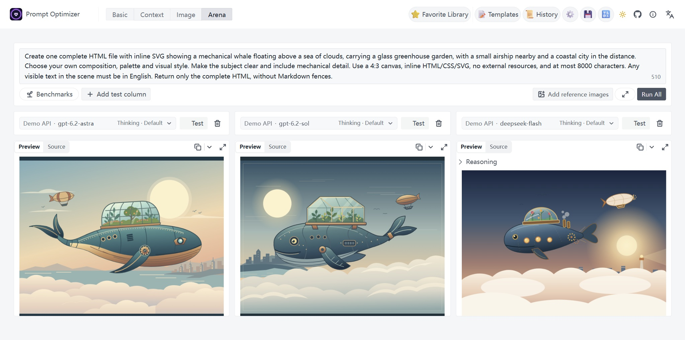

# Arena

Arena sends one task to multiple columns and displays their actual outputs side by side. Use it to choose a target model or compare settings for the same model.

*The same task is sent to three models, each generating an HTML/SVG scene with its inherited default parameters.*

## Start a comparison

1. Configure and enable working models in [Model Management](../basic/models.md).
2. Open **Arena** and enter a complete task.
3. Select a connection and model for each column. Use **Add test column** for more results.
4. To compare settings, adjust the current column's model menu.
5. Select **Test all**, or run one column's **Test** action.

You can also choose a benchmark task or import one from Prompt Garden. You still need your own inputs, model access, and quota.

## Change one factor at a time

| Comparison | Keep fixed | Change |
| --- | --- | --- |
| Different models | Task, reference images, and other conditions where possible | Each column's model |
| Settings for one model | Task, input, connection, and model | One parameter |
| Stability of one setting | Task, input, model, and parameters | Results from repeated runs |

Check task completion, constraints, and factual errors before judging style. Use available run records and provider metering for time and cost.

## Independent parameters

In versions with independent controls, the closed menu shows the current thinking or parameter summary. Defaults are inherited. Editing a column does not change another column or the shared connection.

A model may expose levels, a switch, a budget, or other parameters. Use values actually offered and supported by the service; equally named levels from different providers are not necessarily equivalent. See [Model Selection & Parameters](../basic/model-parameters.md).

## Text, images, and reasoning

- Text models answer directly. Returned HTML or SVG can use the supported preview.
- Image models generate pictures. Use **Add reference images** when needed, with a model that supports those inputs.
- For mixed comparisons, confirm that every column can process the shared input.
- Thinking content appears when the service returns it. Some services offer none or only a summary; visibility alone does not establish capability.

## Continue after a change

Existing results belong to the previous run. Rerun affected columns after editing the task, model, or settings. Sessions retain their task, settings, and outputs; use [Data Management](../basic/data.md) before moving devices.

Arena directly executes and compares tasks. To rewrite prompts, compare original and revised versions, or apply evaluation feedback, use a [basic or context workspace](../user/choose-workspace.md).
