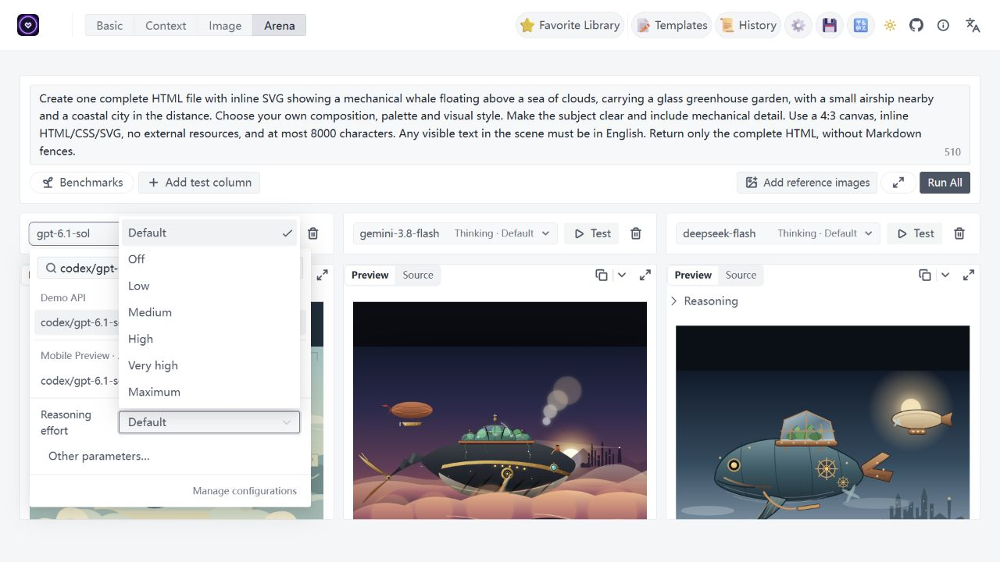

# Model Selection & Parameters

Model Management stores connections and defaults. The model menu selects the model for this run and lets you adjust its parameters independently.

!!! info "App version"
    These independent controls correspond to the November 2026 development build. If your model menu has no parameter section, use the features available in your installed version. Supported parameters and values also vary by provider and model.

## Choose a connection and a model

1. Configure and enable a provider, URL, and credential in [Model Management](models.md).
2. Open a workspace's model menu. Choices are grouped by connection; select an available model within that group.
3. Add another connection when you need another account, endpoint, or provider.

The **connection name** identifies saved settings. The **model name / ID** determines what is called. One connection can offer multiple models without requiring you to enter credentials again for each test column.

## Adjust parameters inside the menu

The closed menu shows a compact setting summary. Open it to edit common parameters or expand **Other parameters…**.

| Existing parameter definition | Possible control |
| --- | --- |
| Reasoning effort | The model's declared levels |
| Thinking switch | On, off, and an inherited default |
| Thinking budget | A numeric input using its native range |
| Other text parameters | Choices, numbers, text, JSON, and more |
| Image parameters | Output format, size, and other settings |

Controls follow existing definitions: there is no universal low/medium/high scale. Models without thinking fields can still expose other parameters. Custom names, structures, and support must match the provider's API.

## Defaults, local overrides, and inheritance

| Setting | Scope |
| --- | --- |
| Model Management defaults | Values inherited by workspaces using that configuration |
| Workspace or test-column parameters | Overrides for this selection, without changing another column or the connection |
| A parameter's restore button | Removes that override and uses the inherited value again |
| **Reset to defaults** | Clears all local overrides for this selection |

**Other parameters…** displays existing inherited values. Select **Edit** to start from a configured value; custom JSON does not require re-entering the parameter name.

The reasoning selector is a shortcut. You can also adjust and restore its original switch, effort, and budget fields independently in **Other parameters…**.

## Compare settings for the same model

1. Select the same connection and model in two columns.
2. Keep the prompt version and input fixed. Change one parameter only.
3. Run both columns and check constraints, factual accuracy, and usefulness.
4. Repeat before deciding which setting to keep.

Run again after changing settings: existing outputs belong to the previous run. Higher effort, more tokens, or a longer answer does not necessarily improve the result.

Use [Arena](../advanced/arena.md) for direct task comparisons, or see [Model Testing Strategy](../user/model-testing-strategy.md) for prompt-version comparisons.
