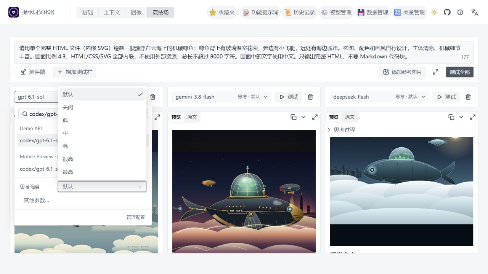

# 模型选择与参数

模型管理保存连接与默认设置；工作区中的模型下拉框负责选择本次使用的模型，并在需要时单独调整参数。

!!! info "适用版本"
    本页的独立参数控件对应 2026 年 11 月开发版。若模型下拉框没有参数区域，请以所用版本的实际功能为准。不同提供商和模型支持的参数、取值范围也可能不同。

## 先选连接，再选模型

1. 在[模型管理](models.md)中配置并启用可用的提供商、地址和密钥。
2. 回到工作区，打开模型下拉框。列表按连接分组，选择该连接下可用的模型。
3. 需要其他账号、接口或提供商时，再添加相应连接。

**连接名称**用来识别保存的配置；**模型名称 / ID**决定这次实际调用什么模型。同一个连接可以用于多个可用模型，无需为每个测试栏重复填写密钥。

## 在下拉框里调整参数

选择模型后，收起的下拉框会显示当前设置摘要。展开后，可直接修改常用参数，或打开 **其他参数…**。

| 已有配置提供的参数 | 可能看到的控件 |
| --- | --- |
| 思考强度 | 该模型定义的档位列表 |
| 思考开关 | 开启、关闭与默认值 |
| 思考预算 | 使用原生取值范围的数值输入 |
| 其他文本参数 | 下拉、数值、文本或 JSON 等 |
| 图像参数 | 输出格式、尺寸及其他配置项 |

界面遵循现有参数定义，不保证所有模型都支持相同的“低、中、高”。没有思考参数的模型仍可调整其他配置项。自定义参数的名称、结构和支持范围以提供商 API 为准。

## 默认设置、本列覆盖与恢复继承

| 设置位置 | 作用范围 |
| --- | --- |
| 模型管理中的默认设置 | 为使用该配置的工作区提供继承值 |
| 当前工作区或测试列的参数 | 只覆盖当前选择，不改写共享连接与其他列 |
| 单个参数旁的恢复按钮 | 移除这个参数的本地覆盖，重新跟随配置 |
| **恢复默认** | 清除当前选择的所有本地覆盖 |

**其他参数…** 会显示尚未覆盖的已有参数及 **跟随配置** 的值。点击 **编辑** 可从该值开始修改；自定义 JSON 无需重新输入参数名。

思考档位是快捷入口。需要独立调整思考开关、强度或预算时，也可在 **其他参数…** 中编辑原始字段，或逐项恢复继承。

## 比较同一模型的不同设置

1. 两列选择同一连接、同一模型。
2. 固定提示词版本和输入，只改变一个要研究的参数。
3. 运行两列，检查约束是否满足、信息是否准确、结果是否适合任务。
4. 重复几次，再决定保留哪种设置。

设置变化后应重新运行；旧输出仍属于上一次运行。更高的思考强度、更多 token 或更长的回答，不一定带来更好的结果。

直接比较同一道题可使用[竞技场](../advanced/arena.md)。比较提示词版本时，继续看[模型选择与测试策略](../user/model-testing-strategy.md)。
